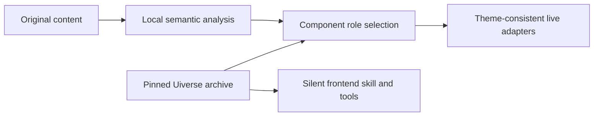

# dsh-intelligent-UI

An independent open-source presentation plugin for the official DeepSeek Harness Desktop, with an offline UI component library built in. This repository contains the intelligent renderer, silent frontend-development tools and themes in one project and one installable plugin. It builds and tests on its own and uses the official application unchanged.

The historical package name **`@lisihao/dsh-solar-intelligent-experience-platform`**, RPC/tool names and data directory are retained for installed-user compatibility. They do not introduce a dependency on another project. The public preview is distributed as a prebuilt GitHub Release archive. npm publication is not required; community-market listing depends on the catalog maintainers accepting its entry.

**内置组件智能**：同一个插件包含 Uiverse 离线组件库、静默前端开发 skill 和自动内容渲染。开发时可按需检索 3,802 个真实组件；展示图表、任务、记录和流程时，自动使用 15 个经过适配验证的组件，并保留原文、数据与来源。

## Built-in component intelligence

Uiverse component reuse is a core feature of intelligent UI, shared by frontend development and live content presentation.

| Path | Automatic behavior | Source evidence |
| --- | --- | --- |
| Intelligent content rendering | Local analyzers recognize charts, tasks, records and flows; semantic roles select approved card/control adapters while keeping the chosen theme. Empryo and other v1 themes participate automatically; v2 component themes keep their selection and v3 ASCII uses native controls by default. | Fifteen compiled source-backed adaptations carry original component IDs and SHA-256 on rendered elements. |
| Frontend development | The model discovers the bundled skill for frontend/UI tasks, searches suitable components and reads their complete source before adapting new controls. Existing suitable project controls take precedence. | All **3,802 components in 11 categories** from the official Galaxy snapshot, with authors, license, original source and hashes. |
| Source-preserving review | Original/comparison views retain text, tables, units and qualifications; isolated previews can be inspected within the authorized task. | The same pinned archive backs lookup and live adapter provenance. |

The archive pin is [`adbd2adde0a299a3956ea288fb444ec01891ca41`](https://github.com/uiverse-io/galaxy/tree/adbd2adde0a299a3956ea288fb444ec01891ca41), dated 2024-09-02. It is a complete snapshot of that archive, rather than a current full-site mirror. Live presentation uses the curated compiled adaptations; the full archive supplies development lookup and sandbox previews. OpenUI still owns its chart marks and native form internals.

The component capability is silent: it adds no library sidebar, page or popup. Its model-invocable skill loads on demand through DSH's official skill mechanism. `solar_ui_search`, `solar_ui_source` and `solar_ui_preview` are included in this plugin; a separately installed component plugin is unnecessary. Normal tool history and the owner's permissions remain in effect. Actual model selection varies with the model and task; runtime semantic layout selection itself requires no extra model call.



See [component architecture and boundaries](docs/design/integrated-uiverse.md), [runtime selector](src/uiverse-render.ts), [silent Host capability](src/uiverse/host.ts) and [source manifest](resources/uiverse/upstream.json).

## Canvas UI integration (development candidate)

The `solar_ui_canvas_search` tool discovers the 35 effects in a fixed Canvas UI catalog for frontend work, including their WebGL factory inputs, cleanup requirements and the appropriate experimental DSH client adapter where one exists. Discovery does not prove runtime availability. The optional `solarExperienceUi.loadCanvasEffect(slug)` client service obtains the requested WebGL factory from that exact upstream revision, checks its source hashes and builds it locally. The plugin package does not redistribute the upstream component sources. This requires access to the official source on first use after a Host restart; failure leaves the original content readable. Canvas UI's [MIT + Commons Clause terms](assets/Canvas-UI-LICENSE.md), including its component-redistribution restriction, remain in force.

The object-effect integration targets explicitly identified GLB records (Ink by default; declared or source-evidenced coding and project-management contexts select ASCII and Glass), and validated, source-declared PNG/JPEG illustrations (Ink by default). Under the GPU ASCII theme, eligible GLB models and illustrations use ASCII Object. Standalone Markdown images explicitly labeled as illustrations can use the same image path. Each illustration keeps a separate, protected original beside its effect. These object effects observe visibility, reduced-motion preferences and a shared GPU budget. Separately, the GPU ASCII theme can project supported visible charts, icons and images through the shared Asciify graphics atlas described below. Original content remains available; rendering does not call a model.

The effect planner recognizes a technical report only when its supplied text contains multiple substantive sections, linked citations and measurements. A small code example or task table does not reclassify the entire report; an explicit source domain takes precedence. This is a presentation hint, not verification of its citations or authorization to distort report text or data. Research-structure and code-context inference skip text over 1 Mi UTF-16 code units; this does not truncate the source or limit chart data. Whole-document inference is skipped when streaming or effects are disabled.

For browsers without HTML-in-Canvas, the client service also offers a bounded `createCanvasHtmlTextureBridge` for non-interactive visual-only content whose source remains visible. It uses `modern-screenshot@4.7.0` under its MIT license; its inert sandbox rejects scripts, external resources, interactive content and unsupported geometry. This is an approximate visual texture, not a data, text-reading or interaction replacement. Consumers must destroy their effect before disposing the bridge; plugin shutdown also retires service-owned resources. Bend and Hex Float are temporarily blocked through the shared client because upstream rewrites document-wide hover styles without restoring them. Other HTML effects, WebGPU and Draco-compressed models need their own browser, interaction and safety verification.

Three experimental, source-preserving client adapters add constrained browser fallbacks: `createCanvasHtmlEffect` supports Shatter, Ripple, Frost, Grid, Displacement, Glitch, Blaze, Particle Reveal, Canvas, VHS, Decrypt Reveal, Magnify, Clouds and Asciify; `createCanvasParticleScrollBridge` pairs a real scrollable source with a separate visual canvas; and `createCanvasIsolatedEffect` runs Bend or Hex Float in a separate sandboxed document. They are explicitly visual-only: original content remains visible, and the adapters reject overlapping, unsafe or unsupported content. Magnify requires `contentRole: 'decoration'` and text-free content because refraction can change how digits appear; the caller must ensure the decoration does not encode data. Its scroll zoom is unavailable to avoid a global wheel listener. Clouds requires an explicit RGB color if a solid source background cannot be inferred. Asciify requires a reliably opaque solid background; its text mask follows the sandbox snapshot, whose fonts and glyph pixels can differ from the original. Set `pointer: true` for visual-region interaction. An initially offscreen HTML effect waits until its source and visual region are visible before requesting a factory; callers can cancel it with an AbortSignal, although an already-started shared import cannot be cancelled. They do not modify another plugin or automatically replace its UI. They have been exercised in an isolated Chromium browser; the official Desktop's CSP and normal consumer path still require acceptance. Native HTML-in-Canvas, complete interaction parity, automatic selection and hardware GPU acceleration are not established by those checks. See the [component evidence](docs/integrations/canvas-ui-matrix.md).

For an opted-in DSH client, the service accepts a dedicated effect host and a separate, visible, non-interactive source. Handle absence or failure with the original view and dispose the returned effect on unmount or disable:

```ts
const effect = await ctx.solarExperienceUi.createCanvasHtmlEffect({
  component: 'glitch', host: visualHost, content: originalVisual,
  scope: 'visual-only', sourceRemainsVisible: true,
  onError: showOriginalFallback,
})
effect.burst() // Glitch only; optional
// On unmount: effect.dispose()
```

`solarExperienceUi.DocumentView` is a read-only client service for other plugin authors to adopt voluntarily. It reuses the intelligent renderer with an owner-controlled original/visual/compare mode and does not rewrite their data or introduce a session. Existing foreign plugins do not become consumers automatically. Removing or disabling this plugin removes its owned service and routes; consumers must provide their own fallback when the service is absent.

This section describes development work beyond the published `0.1.0-preview.2` archive below. A later Desktop candidate passed scoped GLB and structured JPEG checks; a following candidate fixed its broken Markdown `data:` PNG original, and the original and Ink were observed after uninstall/reinstall. The new HTML adapters and subsequent automatic-domain changes still require Desktop acceptance. See [integration design](docs/integrations/canvas-ui.md).

## Local data browser

The current development candidate adds a fixed **数据浏览器** entry in the sidebar. Import UTF-8 JSON, Markdown and TXT, search previously imported files and reopen them across conversations. Files stay in this plugin's own library; importing does not create a Host conversation or submit content to a model. Existing imports are recognized in place without moving or changing them. **生成内容** keeps saved conversation artifacts and no longer carries the import form. Native navigation acceptance is pending the central installer. Original tables in the current development candidate automatically fit their available container and show the resulting scale. **原尺寸** restores a keyboard-focusable horizontal viewport for detail; **适应宽度** restores the full overview. The existing cells, columns, source strings and anchors remain intact. Prose and toolbar controls keep their normal size. Research technical comparisons and chart source tables share this adapter. Very narrow, dense overviews can be small; use native size to read them. Formal Desktop acceptance of this update remains pending.

## Insight preview before PPTX

The development candidate adds **Conversation → 洞察预览**. It reads already-produced Insight task/stage and workflow/node results for that exact session through optional public read APIs. Intermediate analysis is viewable while the original flow is still waiting to produce PPTX. Choose a run/output, inspect charts, tables and the research workspace, switch original/visual/compare, and expand the complete original run record. Opening or refreshing the preview never executes, resumes or changes a flow. PPTX availability is a source-manifest status, not a verified download or a promise of identical slide layout. Missing providers and unreadable records are visible. See [design and acceptance scope](docs/design/insight-preview-data-browser.md). Native live-peer acceptance is pending the central installer.

## Research workspace (preview)

The conversation-level **研究工作区** control adds report, judgments, sources and technical-comparison views inside the current UI-owned output. Reading remains source-preserving. Citation links and table cells open the report-local evidence inspector; returning to a source block retains the report. The inspector distinguishes a reference recorded in the report from an independently checked external source.

The first six components cover judgments, conditions, evidence inspection, technical comparisons, alternative/challenging material and open questions. Explicitly different conditions are grouped separately for charts while every original table row stays available. No causal edge, statistical significance or numeric confidence is invented.

**AI 整理** is opt-in: review its inline fee notice and start a visible request in the current conversation using its selected model. The plugin does not change model/provider/tool settings. The requested task is organization of supplied report text; execution still follows the existing session's permissions, not a new isolated research engine. Returned quote anchors and report identity are checked, but AI interpretations remain **待复核**. Human notes/review and editable question drafts are stored separately. Follow-up drafts are copy-only and never sent automatically.

Research metadata lives only in this plugin's `research/` namespace. Reopening the same source restores its notes; changed source text cannot silently reuse a pending analysis. Uncertain submissions are not replayed. No other plugin's code, original report or session data is rewritten. Cross-session topics, autonomous research, cross-report change analysis and scenario simulation are future work.

This is source/build candidate behavior; the new archive requires centralized Desktop installation acceptance. See [design and interfaces](docs/design/research-workspace.md) and the [candidate acceptance record](docs/acceptance/2026-11-01-research-workspace.md). Screenshots and private runtime receipts are never committed or uploaded.

## What it does

- Optional takeover of standard assistant/tool output and generated content. One conversation-level **显示** control switches visual, original and comparison views.
- Local content analysis chooses suitable icons, charts, table columns, relationship graphs, read-only task boards and list/detail layouts. It preserves original text, cells, units, qualifications and complete tables. Unsupported content remains readable; no model call is required to choose a layout.
- Unmodified OpenUI components supply Markdown, charts, forms and streaming UI. React Flow and ELK supply source-relationship diagrams with animated edges, pause, pan/zoom and keyboard selection. Edges describe source relationships and do not assert that work executed.
- Content-aware Uiverse adapters are selected automatically for supported UI-owned semantic surfaces. Three explicit component themes also supply coordinated buttons, inputs, toggles, cards and loaders, with original-source comparison. Foreign pages retain token/CSS appearance compatibility and their original behavior. See [mapping and compatibility](docs/design/uiverse-component-themes.md).
- Selectable data-only themes control color, typography, roundness, density, depth and transparency. Compatible independent conversation pages receive reversible appearance rules while retaining their original components and behavior.
- The **ASCII** theme adds an Asciify WebGL projection for supported visible graphics and a conversation-header theme selector. Empryo remains the default. Candidate h passed the scoped compact-header Desktop acceptance; the newer graphics atlas still needs its own Desktop acceptance. See [header acceptance](docs/acceptance/2026-11-02-ascii-header.md).
- An optional, explicitly configured MCP Apps adapter preserves UI metadata and uses an isolated bridge. Existing MCP connections are untouched. This connector remains off by default.

The official DSH navigation and settings stay in place. Disabling takeover restores original output/page presentation. Disabling or uninstalling this plugin removes its owned styles, controls and listeners; retained plugin data remains in its own namespace. It does not patch foreign plugin packages, source or configuration.

## Install and use

Compatibility target: **DSH 0.2.1-rc.2**, macOS arm64. Install a built archive through the official plugin manager. Back up affected profile configuration and quit the app before updating an existing installation:

```sh
dsh plugin --profile desktop add --ignore-scripts \
  "https://github.com/lisihao/dsh-intelligent-UI/releases/download/%40lisihao%2Fdsh-solar-intelligent-experience-platform%400.1.0-preview.2/lisihao-dsh-solar-intelligent-experience-platform-0.1.0-preview.2.tgz"
```

Use the official application's bundled `dsh` CLI for an installed Desktop profile. Lifecycle scripts are disabled; the published renderer does not need its optional install telemetry.

In **Settings → 智能体验**, enable **接管输出与兼容页面外观**. Initial takeover is off. The conversation header has one **开启透明** checkbox, synchronized with content appearance settings; in the revised compact header it is under **更多显示选项**. It reveals a wallpaper already supplied by the host; this plugin does not read or change the wallpaper file, and it does not make the native window transparent to the macOS desktop.

### Updating an older two-package installation

Earlier previews installed `@lisihao/dsh-solar-uiverse-components` separately. This feature now belongs to the intelligent UI package. Disable/remove that former companion through the normal plugin manager before installing the integrated build, then restart normally. Its occupied tool/skill/service names produce a clear `UIVERSE_REGISTRATION_CONFLICT` rather than replacing another owner. Preserve existing settings, sessions and other plugins. The preview is supplied as a built GitHub Release archive. Community-market catalog review is separate from downloading or installing it.

### Themes and content appearance

The default theme source is this independent repository's [`theme/` directory](https://github.com/lisihao/dsh-intelligent-UI/tree/main/theme). In **界面主题 → 主题来源**, change the directory address and choose **保存来源**; **恢复默认来源** restores this repository. **浏览来源主题** reads its `index.json`; **下载导入** downloads and verifies the chosen package before adding it to the selector. Network/format/checksum errors are visible and leave installed themes intact. Downloading an identical built-in is acknowledged without duplicating or overwriting it. A custom source can be a GitHub `tree/branch/directory` URL or an HTTP(S) directory with the same catalog format. Source selection persists across restarts; the plugin sends no GitHub credential or private Session data to the theme source.

**Paper · 连续信息流** adds a source-ordered composition inspired by [paper.design](https://paper.design/): an arched intro, wide primary scenes, source-paragraph captions and expandable long argument. Real period tabs and optional demonstration playback select actual charts; narrative tables can use read-only list/detail. It reuses the existing OpenUI charts and a single Markdown AST, preserving reference links, footnotes, full tables and data definitions. Select the downloadable Paper theme with the updated plugin; old themes keep document layout. Streaming and short prose keep their ordinary presentation. See [design / compatibility](docs/design/paper-flow.md).

In the current development candidate, **界面主题** includes built-in Empryo, **经典 ASCII**, **GPU ASCII** and **简洁**. The compact **主题** control in the conversation header selects installed themes without leaving the conversation. The default online source also offers **炭墨 · Carbon**, **钴夜 · Cobalt**, **暖金 · Amber** and **雾白 · Porcelain**, adapted from the supplied Unslop references; see [theme collection and attribution](docs/design/unslop-themes.md). Import a UTF-8 `.dsh-theme.json` package, then select it; importing alone does not activate it. Download the current package or an authoring example from Settings. Removing an active imported theme restores Empryo. Theme selection/import/removal are owner-only, revision-checked and durable.

Empryo uses translucent dark gray by default, rounded panels and subtle hover lift. 简洁 uses an opaque dark gray, system fonts and standard comparisons. The color picker and transparency toggle override appearance; selecting a different theme applies its defaults. Reduced-motion preferences suppress lift and animation.

**经典 ASCII** retains the original graphite/green terminal appearance and pure character comparison charts; its existing `ascii` identity stays selectable. Both ASCII modes now share terminal typography across body, compact headings, chart labels and plugin controls: local terminal fonts with bundled/native fallbacks, no ligatures and tabular figures. Chinese remains selectable native text; font fallback is platform-dependent. **GPU ASCII** (`ascii-gpu`) is separate: supported visible SVG chart/icon geometry, images and explicitly published owned Canvas frames share the actual pinned Canvas UI Asciify WebGL effect, with 6.25px glyphs in 8.75px cells instead of the earlier 2.5px glyphs. Images refresh at up to five times per second while visible and eligible; owned graphs publish their own current frames. This is an approximate visual projection: chart text and labels stay native, small functional SVG icons at most 32×32 CSS pixels stay original, source geometry and values remain unchanged, and the original image or graphic can be inspected. Eligible GLB models and validated PNG/JPEG illustrations use the separate ASCII Object effect; each illustration's labeled original is excluded from the graphics atlas. Unsupported or unreadable graphics stay original; coverage does not extend generally to iframe contents, closed shadow roots or unpublished foreign canvases, and ASCII Sweep is not implemented. Candidate h passed the affected official Desktop header checks at both previously failing window sizes; the newer graphics effects have not yet passed native Desktop acceptance. These changes are not part of the older published preview.

The execution-visualization candidate automatically recognizes source JSON with `kind: "execution-flow"`, or a nodes/edges record with supported status/progress fields. It shows reported roles, source progress, metrics and ordered events, and updates values without re-laying out an unchanged graph. Only explicitly active execution edges receive moving points. Ordinary relationship animation remains separately labeled. Small execution diagrams use the existing ELK/React Flow stack with an owned WebGL2 particle layer; native fine connections stay visible beneath the approximate ASCII projection, and tiny moving lights remain native WebGL to avoid character sampling loss. Pause, reduced motion, offscreen suspension and context recovery preserve source content. Full original fields remain accessible. This is a read-only snapshot renderer, not a private event-bus integration or a task scheduler. A clearly labeled 25-second local replay demonstrates the view without running a model; official Desktop acceptance of this candidate remains pending. See [source contract and acceptance boundary](docs/design/ascii-execution-flow.md).

**柔和浮雕 · Soft relief** now defaults to a dim graphite surface (`#34383d`) with subdued theme-aware raised/inset highlights, replacing the glaring pale default. Saved custom appearance values are preserved; reselect the theme to apply its new default.

In the revised header, **显示** and **主题** stay directly available. On narrow host containers, **更多显示选项** holds the existing research and transparency controls; wider layouts keep them inline. Closing the menu or returning to the wide layout clears only an unsaved transparency preview. The application and other plugins remain unmodified.

Theme packages contain validated JSON tokens, with no executable code, arbitrary CSS or remote assets. Unknown fields/versions, packages above 32 KiB, duplicate/reserved IDs and more than 32 imported packages are rejected. See the [theme examples](theme/README.md), [format and lifecycle](docs/design/experience-themes.md), and [design system](DESIGN.md).

### Optional MCP Apps

Set this plugin's native `mcpEndpoint` Config to the explicitly chosen HTTP(S) server and enable MCP Apps. URLs containing embedded credentials are refused. This adapter denies external resource networks, device permissions and sampling. Model/tool actions use DSH's normal tool guards; durable action receipts prevent automatically replaying an outcome that is uncertain. Opening a saved result reuses that result rather than rerunning the original tool.

## Data and boundaries

Plugin-owned data is confined to `$DSH_HOME/solar/intelligent-experience-platform/`: versioned settings, per-session artifacts, widget state and action receipts. Config limits default to 1 MiB per artifact and 500 artifacts per Session; exceeding them fails explicitly rather than silently truncating source data. Historical sessions cannot recover metadata that the original host never saved.

Appearance support is a bounded adapter to known public conversation-view outlets and neutral variables. Persona, Mnemon memory, context, execution and benchmark controls remain owned by their respective plugins. Their appearance compatibility does not imply that every business operation has been tested. Billion-context's pre-existing unbound-proxy behavior is not fixed by this plugin. The known same-origin ThoughtDAG canvas has an explicit reversible stylesheet bridge; unknown frames, cross-origin apps and unrelated portals are excluded. See [upgrade boundaries](UPGRADING.md) before changing host or external-plugin versions.

## Development

Use Node **22.19+ within v22, or v24+**, and pnpm **10.31.0**. All required DSH packages are published dependencies pinned to the baseline; no host source checkout is required.

```sh
pnpm install --frozen-lockfile --ignore-scripts
pnpm check
```

`check` builds the package, typechecks, runs unit/integration tests and installs the built package into a disposable published-DSH profile. The scratch test runs plain Node and a deterministic local Agent/tool adapter, checks sources/settings/disposal, exercises owner-only theme RPCs and verifies persistence across separate Host processes. It makes no external model call and does not use the installed Desktop profile. Local HTTP transport tests require permission to bind loopback sockets.

For a browser preview:

```sh
pnpm build:preview
python3 -m http.server 4173 --bind 127.0.0.1
```

Open `http://127.0.0.1:4173/tools/browser-experience/`. This preview uses a local stub and synthetic examples by default. `EXPERIENCE_MARKDOWN_REPORT`, `EXPERIENCE_REAL_REPORT` and `EXPERIENCE_LAYOUT_OUTPUTS` accept explicit local inputs. Keep research reports, account data, receipts and captures outside Git. The preview is not installed-app acceptance.

`tools/real-layout-output.mjs --help` exports actual source imports, package commands and reference-analysis records; an explicitly supplied Vitest JSON report adds actual task records. `tools/real-output-demo.mjs --help` and `tools/installed-canary.mjs --help` describe optional retained-profile helpers. Those helpers write to an explicitly supplied DSH home and require separate installation/acceptance authorization; `pnpm check` does not invoke them.

## Verification status

The integrated source is checked through build, types, unit/integration tests and a disposable published-DSH Host with a deterministic keyless Agent. The integration checks the official skill loader, model visibility, original component source, previews, tool availability, runtime role selection, theme/state preservation and disposal. See [current integration evidence](docs/acceptance/2026-11-01-integrated-uiverse.md) for exact results and native acceptance limits.

The scalable-rendering candidate passed formal Desktop acceptance through normal file imports: 10,000 NOAA observations, a 1,000-node / 5,000-edge SNAP citation subset and 1,000 subset-derived counts. WebGL2 and ELK layout, exact range detail, original-data paging, zeros and retained raw hashes passed. The original 361 UI-owned files and other plugin sources were unchanged at the UI-stage boundary; no model call was made. The release gate includes 397 tests and a disposable published-DSH Host/Agent. Native GPU context loss, 388px native width and disable/re-enable were not rerun on this candidate; browser narrow-width checks and historical lifecycle checks have separate evidence. No real-model organization test, exhaustive foreign-plugin business-flow test or npm publication is implied. See [release evidence](docs/releases/0.1.0-preview.2.md). Community-market download-address updates follow the catalog maintainer workflow.

The [Empryo reference analysis](docs/design/empryo-foundation.md), [token catalog](docs/design/empryo-tokens.json) and [local reference atlas](docs/design/empryo-atlas.html) document the visual foundation. They are analysis records, not copied Empryo application source or branding assets.

## License

[MIT](LICENSE). Bundled Recursive and DM Sans font files retain the SIL Open Font License in `assets/Recursive-OFL.txt` and `assets/DM-Sans-OFL.txt`; dependency attribution and redistribution notes are in [THIRD_PARTY_NOTICES.md](THIRD_PARTY_NOTICES.md). OpenUI, React Flow, ELK and other projects are consumed through pinned published packages behind this plugin's adapters, without carried upstream source patches.

### Settings layout

Theme selection, online sources and local theme files use compact groups and a shared control scale. Settings have an opaque backing in the selected background color to keep underlying report text from interfering with controls; content transparency and hover effects remain independently adjustable.

### Hover and background transparency

Ordinary AI reply cards lift slightly on mouse hover; reduced-motion preferences disable the displacement. Hover or focus **开启透明** to reveal the background-transparency range. Drag for a live preview, release to save, or press Escape to cancel an unsaved preview. The checkbox preserves the selected level while turning transparency off/on. Only background alpha changes; text remains solid. High manual transparency can reduce readability over some wallpapers.

Settings writes cross the client wire as validated JSON snapshots. The native save follow-up (including a save after restart) is recorded in [acceptance](docs/acceptance/2026-10-31-opacity-save.md).

Short conversations align above the composer while takeover is enabled. Native chronological order, history navigation and tail-follow ownership remain unchanged; disabling takeover removes this layout adapter. See the [acceptance record](docs/acceptance/2026-10-31-chat-bottom.md) for checks and limits.

Compatible benchmark catalog/run cards and Mnemon status, storage and memory cards share the theme’s hover lift, accent border and elevated shadow. Nested cards lift at the hovered level only; reduced motion removes displacement. See the [card acceptance record](docs/acceptance/2026-10-31-page-card-hover.md).

Theme source validation shows an inline explanation and disables save for malformed, unsupported or incomplete directory URLs. Restoring an unchanged default clears an invalid draft without rewriting saved settings.


### Large source-backed charts and relationship maps

Valid content is no longer refused at 200 table rows or 40 nodes / 100 edges. Long series get an explicit original-value extrema overview with continuous time spacing and exact range detail; categorical comparisons keep source order with page navigation. Full original chart data and tables are paginated rather than silently truncated. Unit, period and comparability safeguards still apply.

Large relationship maps combine an ELK background Worker, a native WebGL2 overview, exact node search and viewport-limited React Flow detail. Complete nodes, edges, labels and source records remain available. Canvas2D and source-order fallback states are explicit; no experimental browser flag is required. This uses the existing pinned dependencies and a thin native drawing adapter, not a redistributed Canvas UI catalog. See [the capacity design and acceptance boundary](docs/design/scalable-content-rendering.md).

These changes ship in **0.1.0-preview.2**. The runtime-equivalent candidate passed formal Desktop acceptance; release-only metadata and package checks are recorded in [the release evidence](docs/releases/0.1.0-preview.2.md). Desktop updates remain separately coordinated. The 3D terrain concept is not implemented in this preview.


The **Generated content** tab accepts local JSON, Markdown and text files through its ordinary file picker and **Import and display** action. Original file text is retained in the UI-owned artifact namespace. Import does not submit a model request or edit session logs. Source units and sampling/subset notes should be included in the file; the configured artifact size/count limits still apply.
