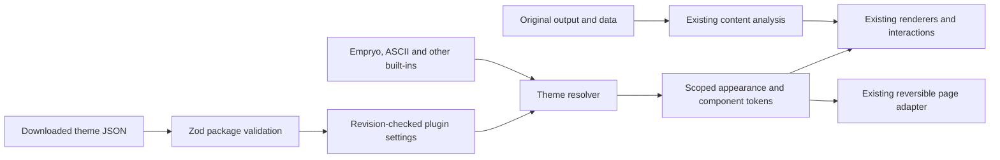

# Intelligent Experience themes

## Goal and acceptance

Turn the current Empryo-derived presentation into one selectable theme. Users can download a portable theme JSON file, import it in Settings, choose it without restarting, remove an imported theme, and retain the selection across application restarts. Existing output analysis, sources, widgets, independent-page operations and reversible takeover remain intact.

P0: extract the current appearance into the built-in **Empryo** theme; preserve existing color/transparency settings; use one theme resolver for reading panels, cards, graphs, comparisons, OpenUI charts and compatible conversation pages. P0 acceptance includes import/select/restart/remove, invalid-file errors, source preservation and takeover/plugin-off restoration. P1: provide a compact built-in **Plain** fallback and a downloadable authoring example. The later user request adds a configurable online theme source. The default is the independent dsh-intelligent-UI repository theme/ directory; executable theme extensions, arbitrary remote assets and background automatic installation remain outside scope.

Affected paths: the IEP `src/` contracts, store/RPC, theme resolver, presentation styles and Settings; theme fixtures and relevant tests; package build configuration and plugin documentation. The user's explicit follow-up requires theme effects on benchmark, memory, context, persona and ThoughtDAG while forbidding changes to those plugins. No official application, foreign plugin source/package/configuration, account store or existing Session data is changed. Existing published OpenUI, Lucide, Zod and scoped CSS remain the implementation dependencies; no new third-party integration is introduced.

## Separation

Themes change presentation, not content recognition or business actions. The Empryo defaults retain the currently accepted appearance. A theme's comparison style can select the organic comparison strokes or the existing standard chart while using the same exact source values. It does not change graph layout, financial units, periods, table selection or source text.

## Package v1

One UTF-8 `.dsh-theme.json` file contains `formatVersion: 1`, `kind: "dsh-experience-theme"`, a bounded lowercase slug `id`, display `name`, SemVer `version`, optional `author`/`description`, required `license`, default `appearance` and typed `tokens`. There is no executable code, free-form CSS, remote URL, archive extraction or external asset loading. Unknown fields/version and malformed values produce named errors before persistence.

Tokens include separate light/dark accents and chart palettes; semantic success/warning/error colors; panel/card/node/control radii; compact/comfortable density; Recursive/system/serif font choices; translucent alpha and blur; bounded hover lift; soft/no shadow; and organic/standard comparisons. Contrast protection and reduced-motion preferences remain mandatory. Numeric tokens use fixed units (px, alpha) with schema limits; theme values are never interpolated into unrestricted CSS.

Built-in manifests are ordinary JSON data consumed by the same schema and resolver as imported packages. They can be downloaded from Settings as portable packages. Theme ids are storage identifiers, not UI labels. Theme storage is bounded to 32 imported packages, with a 32 KiB import-file limit and bounded metadata/palette fields.

## Package v2 and v3

V2 retains the V1 fields and adds a required `componentSet` chosen from the plugin's compiled `soft-relief`, `clear-glass` and `mechanical-outline` adapters. It cannot supply markup or CSS. V3 retains the bounded V1 fields, requires `presentation: "ascii"` and requires `tokens.font: "mono"`. Unknown fields, presentation values and non-monospace V3 fonts are rejected. V1 and V2 keep their existing font vocabulary and validation.

The built-in ASCII V3 package uses a translucent graphite ground and pale green accents. Its source-derived categorical bar presentation requires matching series units and finite values; discrete character marks share a zero-inclusive scale across pages while exact source values and disclosures remain available. Other chart types use the existing renderer. V3 uses native controls by default; its declarative choice does not supply executable rendering code. Eligible explicit GLB models use the existing ASCII Object adapter, while source illustrations and report text retain their own paths.

Existing Empryo remains the default. Candidate g passed scoped official DSH checks for theme selection, source-preserving report bars and selected model/image paths, but its header overlapped host controls at narrower native window sizes. The subsequent header repair has not yet passed official DSH installation and acceptance.

## Persistence and lifecycle

Add an optional `theme` preference to the existing versioned settings document: `{ activeId, installed }`. Missing preference resolves to Empryo with no imported packages. Existing appearance values remain unchanged on upgrade. Selecting a different theme saves its defaults together with the selection in the same revision-checked atomic settings write; later color/transparency changes remain user overrides. Omitting theme selection in an older settings call preserves the current selection/catalog.

Owner-only `installTheme({expectedRevision, theme})` and `removeTheme({expectedRevision, id})` use the same settings queue and return the complete next settings snapshot. Installation does not silently activate a package. Duplicate/reserved ids are rejected. Removing the active imported theme atomically selects Empryo and its default appearance; built-ins cannot be removed. Stale revisions fail without overwriting concurrent preferences.

The existing settings subscription and disposable stylesheet apply theme changes immediately, without replacing original page components or remounting output content. Equal refreshes keep the stylesheet stable. Takeover off removes external-page rules; plugin unload removes its owned styles and resets client theme state. Disabling/uninstalling does not rewrite any other plugin's theme preferences. Existing installation backups remain the downgrade path for older binaries that reject newer optional settings fields.

In addition to Settings, the conversation header can select built-in or installed themes using the same revision-checked settings save. The control exposes a pending state and reports failures; the display-mode and transparency controls remain separate. Selection applies the selected theme's appearance defaults, and later color/transparency adjustments remain user overrides. The revised header keeps display and theme visible on one row. Below 1100 CSS pixels of the nearest existing size container (or viewport when none exists), research and transparency share a native **更多显示选项** popover; wide layouts keep them inline. Closing that popover or returning to wide mode closes the nested slider and cancels an unsaved preview. The revised native header is pending retest.

## Named page coverage

The conversation outlet maps shared colors, fonts, semantic roles and material tokens. Owner-specific adapters cover Persona's actual `.wsp-card-panel`, Mnemon's root-owned `--mn-*` variables, standard-context card/chart roles, benchmark neutral-card sections and the existing workflow studio. Original controls, queries, edits and execution actions remain owner-controlled.

ThoughtDAG is a specific same-origin iframe exception to the earlier no-iframe boundary. The UI plugin recognizes only the installed `[data-dsh-thoughtdag]` wrapper and `/thoughtdag/` frame, then appends its own tagged stylesheet to the frame document. Its semantic CSS roles, font and radii follow the selected theme. One root background layer avoids repeated alpha stacking. The adapter retains the original styles, attributes, local storage, graph geometry, DOM and handlers; load/navigation/removal and off/unload cleanup are exercised separately. Cross-origin or changed mounts are left untouched and produce a diagnostic. This does not grant arbitrary iframe access or modify the ThoughtDAG package.

## Verification

Use focused schema/store/CAS and real renderer checks while implementing. At the stable delivery boundary run the required build/typecheck/unit/scratch-plugin gate once. Use the same unchanged real report and real graph/record outputs for desktop/narrow theme comparisons; verify selected cells and raw text remain unchanged. Native Settings must import a real package file, select it, restore Empryo, and exercise off/on restoration with existing controls. Preserve the current installed profile before an authorized installation. Private reports, screenshots and runtime backups stay outside Git; delivery commits go only to NAS.

## Configurable repository source

Settings optionally persists `themeSource` through the same revision-checked write; older callers omit it and preserve the saved value. Missing values resolve to the independent repository's raw `main/theme/` directory without rewriting legacy settings. The user can save another HTTP(S) directory, use a GitHub tree link, or restore the default.

Owner-only `themeCatalog()` reads bounded `index.json` only when requested; `downloadTheme({expectedRevision,source,id})` rechecks the configured source, catalog identity, bounded package bytes, SHA-256 and the existing data-only schema before importing. Plain HTTP is available for explicit user-provided local sources. Requests omit credentials, reject redirects and time out after 15 seconds. The source receives no session content. Errors leave original themes/settings intact. A byte-equivalent built-in or already installed package is acknowledged without replacement; source/revision changes during download reject stale results. Downloading does not activate.

The source catalog is not a DSH plugin-market release. It belongs to this independent open-source repository. DSH and other plugins are consumers of the presentation adapter and remain unmodified.

## Background opacity override

`appearance.backgroundOpacity` is an optional number in [.3,1]. Existing files that omit it retain their previous defaults. An explicit user slider choice overrides `tokens.translucentAlpha` and automatic alpha raising, while the checkbox still selects opaque vs translucent rendering. Theme switching restores that theme's appearance defaults. Unsaved slider previews are client-local and do not write revisions; completing a gesture uses the normal owner-only settings RPC and existing CAS. The built-package probe includes a custom alpha through real RPC, persistence and Host restart.
