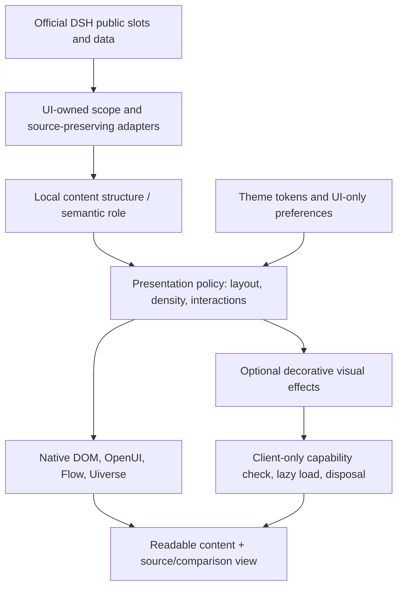

# DSH Intelligent UI: pure frontend enhancement architecture

Date: 2026-11-01
Status: **Design proposal / no runtime change**
Repository baseline: `lisihao/dsh-intelligent-UI@fc53e505e391d7be06464bcba8c8e3b9a24af0d3`
Supersedes: experimental Canvas UI effects foundation PR #1 (closed, unmerged).

## 1. Product contract

DSH Intelligent UI is one independent installable **UI enhancement plugin** for the official DeepSeek Harness Desktop. Its primary users view assistant responses, tool results, generated content and independent plugin views. Technical research is a demanding reference workload for readability, large tables, cross-source comparison and navigation, while the capability remains general-purpose UI presentation.

- The official Desktop application, its navigation, tool execution, agent workflows, models, credentials, memory and other plugins retain ownership of their logic.
- Display and interaction improvements are selected in the browser presentation layer; rendering requires **zero additional model calls**.
- Raw content, values, units, tables, quotations, references and source links retain their original representation. The existing original/compare mode remains available for all compatible presentations.
- Existing display controls and theme packages remain backward compatible. Visual-only preferences, if later persisted, belong to the UI plugin settings, not the `ExperienceArtifact` payload or `solar_present` parameters.
- Plugin disable/uninstall removes only plugin-owned styles, listeners and React contributions. Cross-plugin styling stays reversible and bounded.

## 2. Verified mainline inventory

| Actual path | Current responsibility | Consequence for enhancement |
| --- | --- | --- |
| `src/client.ts` | Official conversation/chat/settings Slot registration, takeover and disposal | Owns presentation lifecycle; do not add Agent-side effect tools |
| `src/presentation.ts` | `ContentView`, `OutputView`, OpenUI, source comparison and streaming | Existing UI entrypoint for opt-in view adapters |
| `src/content-analysis.ts`, `src/content-layout.ts` | Conservative local extraction of chart, table, task, graph and heading shapes | Reuse structured roles; keep it deterministic and source-preserving |
| `src/continuous-view.ts`, `src/paper-chart-deck.ts` | Continuous report sections and staged chart displays | Existing research-oriented surface/interaction |
| `src/uiverse-render.ts`, `src/theme-components.ts` | Uiverse role mapping and compiled interactive controls | Existing reusable component adaptation |
| `src/theme-contracts.ts`, `src/theme-runtime.ts` | Data-only themes and visual tokens | Owns colors, type, density, composition and existing motion preference tokens |
| `src/appearance-style.ts`, `src/page-appearance.ts` | Reversible scoped styling for owned content and known independent pages | Restrict external page changes to proven public styling outlets |
| `src/registry.ts` | Explicit capability/provider routing | Existing backend presentation contract; a GPU-only registry has no justified Host dependency |
| `src/mcp-view.ts`, `src/mcp-host.ts` | Optional isolated MCP Apps presentation | Preserve sandbox and permissions; no shader or DOM injection across boundaries |
| `src/index.ts`, `src/contracts.ts`, `src/store.ts` | Host data/provenance, `solar_present`, versioned settings and Artifacts | No visual effect IDs or shader configuration in saved research data |

The prior PR #1 inserted `effectId` through `solar_present → artifactSchema → Markdown first H1`. The route tied a cosmetic choice to generated-content semantics and excluded ordinary assistant and third-party UI contexts. Its passing tests covered internal correctness of that route; they did not validate product fit or Canvas UI effects on Desktop.

## 3. Target UI composition

### 3.1 Surface taxonomy and ownership

| Surface class | Examples | Allowed modification |
| --- | --- | --- |
| `owned-document` | Assistant markdown, report article and chapter navigation | Source-preserving layouts, accessible interaction and theme |
| `owned-data` | Charts, complete tables, task boards, record detail, flow | Native controls and focus/selection; preserve exact data; **GPU distortions disabled by default** |
| `owned-decoration` | Intro cover, vacant stage background, scene transition | Optional local CSS/WebGL overlays with reduced-motion and visibility budgets |
| `host-public` | Published DSH UI slots, known theme token surfaces | Normal registered slots and reversible styles; avoid native-app patching |
| `foreign-public` | Documented independent plugin outlet and CSS variables | Only validated token/stylesheet compatibility; preserve operation and event handlers |
| `isolated-app` | MCP App iframe or cross-origin / unknown portal | Respect isolation and origin boundaries; no DOM takeover |
| `raw-comparison` | Original and side-by-side review | Original values/source text and layout remain authoritative; presentation effects disabled |

These roles derive from UI-owned renderers or officially addressable slots. They must never be inferred from arbitrary third-party HTML class names as a basis for executing third-party code.

### 3.2 Enhancement policy

Implement a small browser-local `PresentationPolicy` function only when a concrete feature needs it. Inputs are trusted UI surface, selected theme, user preference, reduced-motion/high-contrast preferences, viewport visibility and runtime rendering capability. Output is a bounded view choice with an always-available native fallback.

Priority order:
1. Source and accessibility requirements: selection, keyboard, copy, links, tables, citations, scroll and screen-reader structure.
2. Host/foreign ownership and user choice.
3. DOM layout stability and interaction continuity.
4. Theme, component tokens and composition.
5. Optional effect capability and resource budget.

A component enhancement wraps or overlays only content that the plugin owns. Rendered source content retains stable React keys and the same interactive DOM across layout/visibility transitions. A sibling `pointer-events:none` overlay is preferable to moving interactive children into a new canvas subtree. A failed optional effect releases its resources and displays the original subtree.

### 3.3 Integration boundaries

- **OpenUI / React Flow / ELK:** continue responsible for charts, controls and relationship layout.
- **Uiverse:** retain 3,802 pinned source records for development lookup and the 15 curated compiled adapters for live presentation; preserve source/license provenance.
- **Canvas UI:** treat as a candidate **visual effect source** for `owned-decoration` or isolated demo scenes. Its WebGL engine is browser-only. If an authorized component is later integrated, use an explicit frontend adapter and dynamic import; no Host-side Provider, `solar_present` fields, Artifact migrations or additional Agent work.
- **External plugin page:** visual theme token bridge remains the default. GPU effects may run only where an external plugin explicitly exposes an authorized, compatible visual mount; no assumptions about its private React/DOM ownership.
- **Security / licensing:** executable theme packages and remotely fetched shader code stay disallowed. Audit MIT + Commons Clause permissions for the intended redistributable plugin package before carrying Canvas UI source or compiled components.

References: https://canvasui.dev/docs ; https://canvasui.dev/docs/rendering ;
https://github.com/DavidHDev/canvas-ui/blob/a04a99b235299ee79a123a16ccb2e6cf9da74b6b/LICENSE.md

## 4. Why Decrypt Reveal is deferred

Upstream `src/lib/DecryptReveal/DecryptRevealVanilla.ts` checks for `drawElementImage` and `requestPaint`. Without HTML-in-Canvas it follows a fallback WebGL overlay path with `uCrisp` enabled. Full text reveal therefore requires an actual embedded-Chromium visual check. The prior draft did not load the shader at all. Upstream React wrappers own a canvas and use `destroy()` at unmount, but this alone does not establish compatibility with DSH React18, context loss or reparented interactive content.

A first GPU candidate should be selected only after direct Electron environment capability detection and a side-by-side visual trial for a decorative surface. Canvas UI's native-overlay-supported effects (e.g. Ripple/Glass) are possible candidates; acceptance depends on actual visual results, resource release, text selection and zero event interception.

## 5. Prioritized UI work

### P0 — Research reading and evidence interaction, reusable for ordinary replies

A. Improve section navigation for long reports: stable scroll target, visible active focus, keyboard state, restoration across polling and responsive outline layout. Reuse `HeadingIndex` and existing source positions.

B. Improve source/data comparison: one-screen navigation between visual result, complete source table and relevant qualification. Preserve the present original/compare controls and every source string.

C. Strengthen mixed-content streaming: avoid view remount and scroll jumps as Markdown completes or tables become eligible for visualization; explicitly test active disclosures and manual scroll position.

D. Cover compatible foreign-plugin pages with scoped tokens and a documented opt-out policy. Continue avoiding changes to their state or events.

### P1 — Unified UI design tokens and interaction quality

Create an explicit **surface role vocabulary** shared by plugin-owned components. Extend the current Uiverse role mapping only for verified component roles. Review focus ring, hover, responsive density, high contrast and long-content overflow. Test interfaces with no model call and in the original mode.

### P2 — Optional visual effects

After a renderer capability probe and licensing review, integrate one authorized Canvas UI component within an `owned-decoration` slot only. Keep default off, reduced-motion aware and lazy loaded. Track actual FPS, per-context memory, resize/hidden-tab behavior and teardown.

## 6. Acceptance and performance measurement

Use both deterministic browser tests and normal installed-DSH Desktop canaries. No numerical target below is a claim of current measurement.

| Metric | Suggested gate |
| --- | --- |
| Agent / model activity | 0 extra model calls per UI render, theme switch, focus or comparison |
| Source fidelity | Exact source strings, units, qualifications, citations and table cells preserved; no permanent hidden data |
| Reversibility | Takeover off, other-plugin navigation, plugin disable/uninstall restore original operation |
| Interaction continuity | Link activation, keyboard, copy, pointer and existing widget state survive view switching/polling |
| Render stability | No unexpected remount/scroll jump under representative streaming and refresh fixtures |
| Runtime costs | Compare frame-time p95, long task count, JS heap/GPU memory against baseline on actual Desktop |
| GPU gating | Optional GPU effect never initializes under reduced motion/offscreen/disabled conditions and releases listeners/GL on unmount |
| Ownership | No changes to DSH core, external plugin source, external Agent execution or persistent Artifact schemas |

Benchmark fixtures: a long Markdown report with references/footnotes, 13+ full tables and several charts; an actively streaming assistant reply; a generated-content artifact with open disclosures; a foreign-plugin page; a narrow Desktop layout. Retain screenshots, session/source hashes and timed interaction traces.

## 7. Immediate implementation slice

**UI-only chapter-navigation focus/active-state feedback**. Modify `src/layout-views.ts` plus a focused browser test. Make a focused heading visibly distinguishable after TOC navigation while preserving source position, original text, keyboard operation and scroll ownership. It requires no new dependencies, no Host schema changes and no model call.

Complete this vertical slice and measure it in the browser fixture before starting a GPU component migration.
