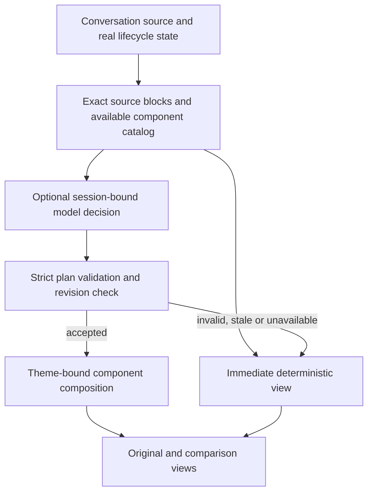

# Adaptive conversation UI: component integration and model composition

Status: **design proposal for owner review; no implementation or installation**. Researched on 2026-11-05. Owner: the independent `lisihao/dsh-intelligent-UI` repository. Source baseline: [`529984522b69f0ed20cf9039c2dabae9fc3f1e65`](https://github.com/lisihao/dsh-intelligent-UI/tree/529984522b69f0ed20cf9039c2dabae9fc3f1e65), the Canvas/content candidate, rather than the older default branch. Other pending UI branches remain separate; this proposal does not merge or supersede them.

## Intended behavior and completion boundary

A conversation can contain prose, measurements, live observations, comparisons, explicit relationships and real task records. A decision layer selects a composition from the installed design system for each source block. The renderer binds that composition to the original content and updates it as the source changes. Neither a model nor a visual adapter can silently replace facts, units, qualifications, source links or execution state.

The requested three libraries become first-class, discoverable library entries with pinned provenance and working adapters: Skullet for loading, Torph for changing short labels/numbers, and Liveline for actual live series. The reference stack also informs a visx historical-chart adapter and reuse of existing React Flow. A catalog entry, a compiled adapter, a selected layout, an actual native rendering and an accepted installation are distinct milestones.

Observable implementation acceptance: through the normal conversation output path, appropriate sources select and render these components, content updates preserve identity and original access, invalid model plans visibly retain the deterministic view, and disabling the plugin restores the normal Host presentation. A real model selecting a plan is required before calling model composition usable. This design document establishes none of those runtime results.

## Observed implementation

| Existing owner | Observed behavior | Consequence |
| --- | --- | --- |
| `src/presentation.ts`: `ContentView`, `MarkdownContent`, `StructuredContent` | Local analyzers select layouts; Markdown structural analysis is withheld during streaming. OpenUI, dense plots, comparison plots, boards and React Flow already have paths. | Keep this as the immediate and failure rendering path. A simple answer remains prose. |
| `src/content-analysis.ts`, `src/content-layout.ts`, `src/content-sections.ts` | Source-derived chart, record, relationship and chapter plans. | Reuse extraction and exact source identities instead of asking a model to regenerate data. |
| `src/public-api.ts`, `src/client.ts`: `ctx.provide('solarExperienceUi', uiClient)` | Live client service exposes widget registration, `DocumentView` and visual effect adapters. | This is a presentation service, not a general model decision service. Extend it compatibly. |
| `src/client.ts`: `submitResearchPrompt`; `src/research-host.ts` | Explicit visible requests are queued in the current session; `solar_research_submit` receives logged, session-bound results. | There is an established same-session request/tool-return pattern. It is not an automatic sidecar. |
| `src/uiverse/host.ts`, `resources/uiverse/` | Bundled lookup, source provenance, tool registration and on-demand model skill. | Extend discovery rather than adding another component browser or plugin. |
| `package.json`, `build.mjs`, `DESIGN.md` | React/React DOM 18.3.1 are Host peers; React Flow 12.12.0 and ELK 0.12.0 are pinned dependencies; Tailwind 3.4.17 is a development dependency; existing theme tokens and controls govern appearance. | Share Host React. Keep the accepted theme and plugin-only build. Do not migrate styling or replace the official app. |

The owner clarified that the existing open-source Jev plugin and its configured OpenAI Decisions connection are the intended judgment service. A read-only inspection confirmed that installed `@dsh-jev/plugin@0.1.0` exposes `ctx.jev`, `registerFeature`, `judgeOnce`, `judgmentConnectionIdentity`, feature-state methods and action receipts. Its installed configuration selects Luna Decisions through the `luna-openai` connection. This is installation/configuration evidence, not a live service or network-success check. No credential value was read or emitted, no Jev function was invoked, and no feature was enabled. Earlier inspection of the UI/main V4 repositories alone did not cover this independent plugin.

## Upstream sources and pins

All three repositories were cloned outside the product checkout and read without running their installation, build or test scripts. npm registry metadata was separately checked for the exact candidate versions. A repository HEAD is analysis provenance; it is not proof that the registry archive contains identical source. During implementation, inspect the exact pinned package archives and retain lockfile integrity before declaring the shipping artifacts verified.

| Component | Primary project and inspected commit | Candidate package / entry | License and Host fit |
| --- | --- | --- | --- |
| Skullet | [lochie/skullet](https://github.com/lochie/skullet/tree/770cba428e6954977fd97938f0f06a7cade2fc2d) | `skullet@0.0.3`, `skullet/react`; styles export `skullet/styles.css` | MIT, copyright 2025 Lochie Axon. React and React DOM peers accept >=18. Vue/Svelte peers are optional and are not used. |
| Torph | [lochie/torph](https://github.com/lochie/torph/tree/d79a5aa63226acf97d49c3e34fafb2e85c07b026) | `torph@0.1.3`, `torph/react` | MIT, copyright 2025 Lochie Axon. React and React DOM peers accept >=18. Only the React entry is selected. |
| Liveline | [benjitaylor/liveline](https://github.com/benjitaylor/liveline/tree/069899598a11e00094ea1eb6b838404825f828be) | `liveline@0.0.7`, `liveline` | MIT, copyright 2025–2026 Benji Taylor. React peer accepts >=18. |

Skullet's package builds its inline support, TypeScript bundles, Svelte output and CSS. Torph builds with tsup and a Svelte build script. Liveline builds with tsup. The plugin consumes their published, already-built React entries; it does not execute these upstream build scripts, ship their demo sites, copy modified upstream source, or add Vue/Svelte runtimes.

Registry archive integrity observed during research:

| Package | SHA-512 integrity |
| --- | --- |
| `skullet@0.0.3` | `sha512-YPKHasYQxuZTQ6Tf6ap61lseIjdAklQlScg48HMKJW/AiGg8HaVdbfzg5XW/j6OdRuJbITpwsG5vJ8LAapmMJA==` |
| `torph@0.1.3` | `sha512-DOirbURFAedEZlK6Mx9jcAc7/gbDBUZNyXQwHUmQRXyUsbB3STYwb2PjiAy9iMc1eOWoQLfhm54DuPhWBPEibg==` |
| `liveline@0.0.7` | `sha512-S1Weo1kmefiOCNaW/WFXErqJXlV8A/ldIkIthaOeT57I2ZhqhKLKQDJ1wfabtMSK9vJeU8PeMNHd8Sr8TLByWQ==` |

The first-use path is offline after ordinary plugin installation: exact npm dependencies are resolved into the normal plugin profile and browser code is bundled by the existing esbuild pipeline. Any required CSS is scoped to UI-owned surfaces. Keep full MIT notices in the shipped package and record adapter/API pins and upgrade checks in `UPGRADING.md` and `THIRD_PARTY_NOTICES.md`. No Python, subprocess, model weights, additional server, or new non-npm dependency is needed for these libraries. Do not fetch component code from a CDN during a conversation.

The [visx project](https://github.com/airbnb/visx) supplies composable SVG visualization primitives rather than a ready-made historical-chart product. Registry candidates `@visx/shape`, `@visx/scale`, `@visx/axis` and `@visx/responsive` were observed at `4.0.0`, MIT; the React-bearing candidates declare React 18/19 compatibility. These are **provisional** until their exact archive, license and source/API review is complete. Build the first historical line/bar adapter only after that review; keep existing chart coverage while it is incomplete. Do not claim that all OpenUI chart types have moved to visx.

[shadcn/ui](https://ui.shadcn.com/docs) primarily distributes open component source. It is not a generic runtime package that can simply be added underneath an existing app. This proposal adopts the reference's layered design idea while preserving the existing theme controls, OpenUI and scoped Tailwind pipeline. It does not copy/modify shadcn source or claim an actual shadcn integration. If the owner requires literal shadcn primitives, identify specific controls and review their distribution/provenance path separately before changing this boundary.

## Component responsibilities

| Source or UI state | Chosen surface | Conditions and preserved meaning |
| --- | --- | --- |
| Initial asynchronous data load | Skullet skeleton around a known, read-only surface | Loading comes from the actual request state. Samples represent geometry only, are inert, and never appear as real numbers or enter model input. Unknown structure uses a neutral placeholder. |
| Refresh of already visible data | Existing content plus freshness/loading text | Do not hide useful values behind a fresh skeleton. Error and empty are separate states; an error cannot leave a permanent loading animation. |
| A changed short status label or metric | Torph | Use stable labels and original formatted values, including signs, units, precision and missing-value distinctions. No morph of long prose, code, citations or editable input. |
| Time-stamped observations from a declared live source | Liveline | Source identity, timestamp unit/time zone, value unit, ordering and freshness must be known. Convert milliseconds explicitly; Liveline points use Unix seconds. A growing assistant text stream does not make static numbers live. |
| Historical time series or comparable numeric data | visx adapter when implemented and available; otherwise current charts | Original sampling, gaps, units, baselines and qualifications stay available. No fabricated intermediate measurements. Reuse complete source tables. |
| Explicit strategy, dependency or workflow relations | Existing React Flow + ELK | Every node and edge binds to a declared source relation. Chronological adjacency is not proof of causality; a strategy diagram is read-only unless a separate execution feature is authorized. |
| Few comparable numbers, task records, named records, ordinary prose | Existing compact comparisons, board, master/detail, Markdown | Select the simplest suitable surface. No dashboard or chart is required just because a component exists. |

A registered component declares its semantic role, input schema, upstream pin/license, runtime availability, update policy, accessibility/fallback behavior and adapter version. Discovery and runtime use share this catalog; availability means a loaded/validated adapter, not a website link. The component library serves both frontend development lookup and normal conversation presentation. Preserve existing Uiverse IDs/tools and extend search results compatibly; do not silently redefine the existing `solar_ui_source` contract for unrelated source types.

Apply current theme typography, spacing and semantic colors. For ordinary live charts, disable optional chart shake/particles, exaggerated scales and directional gain/loss coloring unless the source explicitly supplies that meaning. An increase in latency is not automatically good. Always distinguish visually interpolated motion from measured data; exact latest values, timestamps and the complete original window remain readable outside the animation. Missing/out-of-order/invalid data cannot be silently converted to zero or relabeled as current.

For reduced motion, Torph falls back to plain text; Skullet uses no animation; a live chart can use a static exact snapshot with source updates instead of assuming that a `paused` animation is fully motion-free. Verify actual upstream behavior and cleanup. If a chart disappears offscreen or the document is hidden, suspend unnecessary work; on resume, reconcile against the latest source revision. Bound the active display window without dropping retained source records or changing other plugins' subscriptions.

## Model composition and the Jev boundary

Use a Jev-style separation of observation, decision, validation and rendering. The model chooses a semantic composition; deterministic code validates and executes that *presentation plan*. It does not receive arbitrary JavaScript/HTML execution, network access, task-control permissions or authority to invent data.

**Preferred decision path: reuse the installed Jev Host service.** The UI plugin registers one separately controllable consumer feature (proposed ID `ui-composition`) through `ctx.jev.registerFeature(...)`, owns its disposer, and checks `isFeatureEnabled`. New Jev feature IDs are disabled by default in the inspected service. Activation must be explicit and scoped to UI composition; do not enable unrelated Jev hooks, lanes, guidance, supervision or completion checking. The current request authorizes designing and developing this consumer, not changing live profile settings or running a paid probe in this design turn.

The service's typed request is `{ state, questions }`. Its questions are `choice`, `score` or `noul`; it is **not an arbitrary JSON-layout generator**. Therefore deterministic analyzers first generate eligible candidate compositions from the exact source, catalog and runtime capabilities. Jev receives bounded `choice` questions whose option IDs identify those candidates. One question can select a valid surface for each stable block; another can select among compatible overall arrangements. Build and validate the final plan locally from the chosen IDs. Do not parse `legend`, probabilities or confidence as new data, generated code or layout instructions. If only one eligible candidate exists, apply it locally without a paid decision.

Call `judgeOnce` rather than the interactive `judge` path. Supply `featureId`, source/session links, `refresh`, `preflight`, `interpret`, `canAdopt`, an AbortSignal and a snapshot from `judgmentConnectionIdentity()`. Preserve the current saved protocol, endpoint, model and credential reference. The service resolves credentials and records request/response/usage; UI code neither reads keys nor constructs a parallel HTTP client. Do not reinterpret the configured Decisions protocol as Chat Completions or change the owner's model settings.

Only a `kind: 'ok'` result with still-current source/catalog/runtime state is eligible for adoption. `failed`, `cancelled` and `not-adopted` keep the immediate deterministic rendering; no human Retry/Cancel prompt blocks the conversation and no silent retry starts another request. Log a receipt only for the stage actually observed: a valid choice is not yet a rendered view, and a mounted diagram is not executed business work. Receipt-write failure leaves its status unconfirmed and never causes the model request to be replayed.

The inspected public service source is the owner's existing Jev continuation at `38a7371dbfa621894b14ef0a65c4bd64859838e7`, under `packages/jev/src/index.ts`, `types.ts`, `wire.ts` and `adapter.ts`; the installed public declarations also include these methods. Before implementation, compare the exact installed runtime closure with the intended source/artifact: a shared `0.1.0` version string alone is not an adequate compatibility pin. Do not modify or redistribute Jev as part of this UI feature. Model it as an optional external peer/service; an absent/incompatible/disabled service leaves local UI usable. Add a non-executing capability check rather than importing a private Jev implementation or bypassing its feature gate.

The existing session tool path remains useful for recording supplied source and model-visible effects. Auxiliary Jev requests belong to its existing ledger. The public `JevOperationLink` has optional `sessionId`, `runId`, `stepId` and `inputVersion` fields, not a native Session-cut cursor. Bind the source snapshot through `sessionId` and a stable `inputVersion`; retain the exact reconstruction input in the recorded `state/questions`. Preserve enough ordinary Session source plus versioned deterministic candidate metadata to reconstruct everything sent to the decision model; if a normal logging seam cannot satisfy that contract, record the missing seam before activating the consumer. Do not add custom Session events or silently insert an Agent message to simulate an auxiliary decision. Historical organization can remain an explicit visible user action. There is no need to queue an extra general chat-model turn for every rendered response.

### Proposed plan contract (not an existing API)

Local code builds a versioned plan from validated Jev candidate choices, bound to one session, one source revision and one catalog revision. A source reference identifies an existing block/range or structured-data path. The plan specifies a registered component role, layout/placement, allowed presentation options and the candidate eligibility reason. Source text, numbers, graph edges, units and status values are resolved by the renderer, not accepted as new model-supplied facts. The proposed `solar_ui_compose` tool or equivalent ordinary tool boundary can expose this source-bound operation; it is not an existing registered tool and it does not allow arbitrary layout JSON from Jev.

- Validate at the tool/model JSON and durable-file boundaries. Reject unknown format versions and component IDs, invalid field types, unavailable adapters, mismatched session/revision, dangling references and non-source data bindings with named, visible reasons.
- Enforce component-specific eligibility independently of model choice. A model cannot declare a stale snapshot live, make an absent metric zero, activate an effect unsupported by the browser, or turn a description into a task action.
- Keep complete source coverage: blocks not referenced by the plan still render in source order. An accepted composition cannot discard qualifications, remaining table rows, citations or unsupported material. Layout changes preserve each block's original inspection path.
- Bind decisions to source/catalog/adapter versions; use stable block identities to retain disclosure, chart window, scroll and focus state. New live values update data bindings without requesting a new model plan for every tick.
- Do not reorganize unfinished streaming prose repeatedly. Render partial text immediately; compose stable completed blocks. Delay topology changes while a user is selecting text, operating a control or inspecting a plot. Discard stale decisions after cancellation, source change or conversation switch.
- Reuse the last valid plan only for its exact compatible fingerprint. A provider failure keeps the deterministic content and shows a concise local explanation; it does not masquerade as model success or trigger silent retries.
- All model-visible context must be reconstructable from ordinary Session source/tool records plus the versioned deterministic candidate construction; the exact auxiliary request/response is retained by the existing Jev ledger. Give the model only the relevant supplied blocks and component capabilities. No hidden browsing of other conversations, account settings or provider secrets.

Persist only the accepted source-bound plan and its minimal receipt in the plugin's own existing `$DSH_HOME/solar/intelligent-experience-platform/` namespace, if persistence is needed for reopening. This namespace is established in `src/index.ts`; do not reuse Jev's private storage directory. The record needs a format version and deterministic source identity; unknown versions are refused by name. Do not modify Host session records or add custom Session events. No real conversation content or runtime receipts belong in Git. A same-turn tool result should carry the accepted candidate IDs and validation result so a later view can explain selection without displaying private reasoning.

## Dynamic behavior examples

The following are hypothetical acceptance fixtures, not observed native results:

1. A tool is loading an explicitly requested metric stream. Its known read-only frame uses Skullet. When real time/value pairs arrive, the frame reveals Liveline and an exact current value. A later connection failure retains the last confirmed values and names the stale/error state.
2. A report contains a three-year numeric comparison and several conditional judgments with citations. The model selects the historical chart adapter for the comparison and existing reading/evidence surfaces for the prose. The chart does not animate as a live feed; complete rows and qualifications remain accessible.
3. A strategy result contains explicit nodes/edges and current observations. The model selects React Flow for the relationships and a separate supported metric surface. Changing a filter or opening a node never executes the strategy.
4. A short answer contains no structural data. The decision is plain Markdown, with no empty charts, invented metrics or skeleton shown after completion.

## Implementation ownership after review

All work belongs to this single independent plugin and a dedicated feature worktree under Projects. Do not edit the old V4 checkout, installed app, another plugin, credentials or existing user sessions. Do not merge unrelated feature branches to get this work underway.

| Slice | Affected paths (proposed; names may be refined at implementation) | Exit evidence |
| --- | --- | --- |
| Component catalog and provenance | `package.json`, `pnpm-lock.yaml`, `src/adaptive-ui/`, existing Uiverse discovery adapter, `build.mjs`, `assets/`, `UPGRADING.md`, `THIRD_PARTY_NOTICES.md` | Exact package archive review; shared React; built browser entries and notices ship; actual component lookup returns provenance. |
| Read-only component adapters | `src/adaptive-ui/`, bounded call sites in `src/presentation.ts`, current theme/style modules and `DESIGN.md` | Skullet/Torph/Liveline normal and failure states, original/compare access, no false live selection, cleanup and reduced motion. visx archive review precedes its adapter. |
| Decision contract and session binding | `src/adaptive-ui/`, `src/index.ts`, `src/contracts.ts`, `src/remote.ts`, `src/typert.ts`, `skills/` and the existing client service boundary where needed | Valid Jev choices produce a source-bound plan through normal UI call sites; bad/stale/cross-session results fail visibly; scoped feature enablement and no retry/task action. |
| Delivery evidence | Focused `tests/`, existing plugin-test fixture, browser preview, plugin README and acceptance document | Built `lib/` boots in scratch published Host; browser behavior; identified source commit and PR. Native installation/real model results reported separately. |

Keep independent catalog/source review work parallel where useful; serialize shared contracts, Git state, generated output, installation and final integration. No version bump, public package publication, merge or release is part of this proposal. Native installation and paid probes require their existing separate authorization; do not call an archive/build a usable installed feature.

## Verification plan

This turn is an **L0 design/source review**: inspect the upstream licenses, API entries, published version metadata, owning source and final documentation diff. No build/test or model claim is made.

Implementation is at least L2; accepted plan persistence/format introduces the project's L3 persistence boundary. Use the existing required build, typecheck, unit and built-package scratch plugin gate at the stable delivery boundary. Reuse unchanged evidence and run affected checks after fixes. Tests must exercise normal UI call sites as well as plan validators; an isolated adapter that is never selected does not satisfy this task.

Required falsifiable cases include initial load/reveal/error/empty, short text and signed/decimal/unit-bearing numeric updates, a true live series versus a static table, timestamp conversion and missing/gapped/invalid observations, history-chart complete source retention, explicit versus invented graph edges, valid and rejected model plans, incomplete streaming content, source revision/cancellation races, stable interaction state, plugin disable/unmount, and absent decision provider. Include Chinese/CJK text, default and narrow containers, keyboard use, light/dark/current themes and reduced motion. Verify chart access without depending on canvas pixels alone.

Real model acceptance must show a normal conversation selecting at least distinct prose, chart and relationship presentations from the catalog and retaining exact source access. This requires approval for actual model use/cost and a native installation where required. Distinguish tested local determinism, model decision quality, native browser/runtime support and measured performance; do not claim better comprehension, lower latency or cost savings without representative evidence.

## Review decisions

The proposed implementation is one plugin with three new pinned library adapters, source-bound candidate composition, current-theme controls and a scoped consumer of the installed Jev service. The model's role is selection and layout; data eligibility, preservation and lifecycle state stay with deterministic code.

Owner review is needed before integrating the open-source libraries, as required by the project rule: “Before any code, write `docs/integrations/<project>.md` … 昊哥 reviews the document before implementation.” The owner has identified the installed Jev/OpenAI Decisions route. Review should confirm the bounded candidate-selection design and the staged historical-chart approach. The reference to Tailwind + shadcn is treated as a layering reference; a literal shadcn primitive migration is outside this proposal and is not claimed complete.
