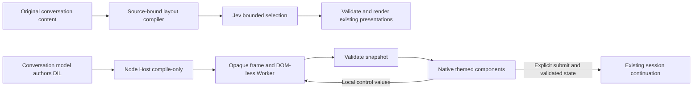

# DIL generative UI integration

## Scope and reference identity

The owner requested integration of the useful missing mechanisms in three DSH intelligent UI projects. Source was cloned/read before running any project scripts. This document describes the implementation contract; acceptance is recorded separately. This is a feature inside this plugin, not installation of three additional plugins or modification of official Harness.

| Reference | Exact commit | License and selected contribution |
| --- | --- | --- |
| [Zephinel](https://github.com/Zephinel/dsh-intelligent-ui) | `ca7bc47cc9ae589d361d57248e10e8fc4f3220d0` | MIT. Conversation-gated authoring guidance, validation and rendering tool-start arguments before result metadata. Adapt these behaviors to our existing OpenUI renderer, state persistence and complete action/state continuation. |
| [comeonzhj](https://github.com/comeonzhj/dsh-intelligent-ui) | `68426b8477915a6cb469d2179c4eeccc5d575d69` | MIT, with Apache-2.0 ECharts separately bundled there. Study `compileDil`'s program/constants split, native component catalog, local handler/state loop and explicit submit. Do not import its whole client, ECharts distribution or in-page execution fallback. |
| [yunyv](https://github.com/yunyv/dsh-intelligent-ui) | `c4920ad2327ee5dfdfb42744e4696286868d934e` | MIT; its vendored replica has a separate MIT notice, copyright DJJ. Consume the unmodified compiler and complete opaque-origin iframe/Worker envelope at this fixed Git identity, behind local adapters. The vendored README explicitly states it does not distribute OpenAI runtime bundles. This is a replica integration, not an assertion of OpenAI compatibility. |

The last reference's package includes the TypeScript compiler and generated runner sources but exposes no standalone public compiler/runtime export. The fixed reference is a build-only dependency; its selected source closure is bundled into this plugin, rather than activating a companion plugin. The adapter therefore resolves the fixed dependency's package root at build time and aliases only `src/dil/index.ts`, `src/client/dil/sandbox.ts` and `src/client/dil/frame.ts`. Normal esbuild compilation is permitted; upstream files are not copied into our source or edited. Seven entry/core/generated files are checked against recorded SHA-256 values before resolving these aliases. This is an entry-point integrity guard, not a claim that every transitive file has its own recorded hash. Record these internal API dependencies in UPGRADING.md. Do not load the reference's plugin entry, sidebar, tools, renderer, persistent store or HTML escape hatch. Host peer modules remain supplied by Harness.

## Why this differs from layout selection

Our existing source compiler selects finite executable presentations for original text. It does not generate new interaction logic. DIL adds a second authoring lane: the main conversation model writes Markdown, component tags and state/computation statements. The Node Host compiles them into a program, constants and diagnostics. The pinned compiler uses `node:vm.Script` for syntax work and must never be bundled into the browser; a build guard rejects that import. Streamed source is debounced through a compile-only Host RPC, not compiled or evaluated in the main page. Only the browser's isolated runner evaluates that program. A validated tree is adapted to this plugin's native components. Jev remains a bounded decision/placement consumer; its choice-only Decisions response is never treated as a program generator.

The selected reference sends serialized tree snapshots; this adapter validates them and lets React reconcile the native tree. It does not port comeonzhj's separate `CREATE/SET/TEXT/PLACE/REMOVE` transport or assert compatibility with an OpenAI operation stream.

Existing OpenUI Lang remains supported. Its persisted widget state and full `{action,state}` continuation must not be replaced by a weaker text-only bridge. Semantic Markdown for code, math and source directories remains a base rendering guarantee beneath either lane.

## Feature and data contract

- Retain the saved default-off block compiler experiment and its configurable shortcut. DIL execution is part of that opt-in experiment; switching it off disposes the runner and retains readable original source. Enabling it does not enable another plugin or change a model/provider connection.
- Add an explicit DIL artifact protocol. The host receives source, compiles it using the pinned compiler, and stores the original source plus the versioned compiled payload and provenance in this plugin's existing namespace. Model-provided arbitrary compiled JavaScript is not accepted as an authoring interface.
- Gate generation guidance and DIL tool availability on the relevant settings. Describe only components the local adapter actually implements. Use existing official system-prompt/tool/conversation seams and normal logged tool arguments/results. A missing optional prompt service must not prevent plugin loading.
- Show partial tool arguments in a temporary source-bound renderer; a completed result replaces that temporary view with its durable artifact. Preserve local keyed state across compatible constants/source updates and normal remount/restart through the existing revision-checked widget-state API. Reject stale saves and unknown durable versions.
- All source, program, constants and state JSON cross real validation boundaries. Bound authoring size, tree depth/count, props, handler references and state using named errors. Keep diagnostics and readable source on compilation/runtime failure. Do not silently substitute a different artifact or resend a model request.

## Execution and native rendering

Preserve yunyv's complete `buildRunnerHtml` + `DilSandbox` structure: iframe with `sandbox=allow-scripts`, opaque origin, hash-pinned bootstrap, no-network CSP, DOM-less Worker, protocol version and lifecycle/watchdog. The normal view requires a trusted runner URL supplied by the owner-authenticated Host RPC. A lifecycle-owned loopback server serves only the pinned static document at a random path; source, program, constants, state and credentials are not sent to that HTTP service. The main page sends those payloads over the reference message channel. The normal consumer never selects the reference adapter's optional `srcdoc` mode. There is no main-page eval or inline execution fallback. A failed/unavailable runner leaves the original and diagnostic accessible. Do not weaken official Desktop CSP or rebuild the app.

The host accepts only a bounded, versioned serialized tree; it never inserts untrusted HTML. Support the reference's concrete intrinsic vocabulary through explicit native adapters: layout containers, text/title/code, cards/badges/progress, buttons, inputs/text areas, checkbox/radio/select/slider/segmented control, tables/lists, supported chart specifications and safe links/images. Use the existing Theme components, rich Markdown, OpenUI charts and source-owned presentation tokens. Unknown tags/props have visible fallback/diagnostics rather than arbitrary DOM behavior. Do not advertise unrestricted PascalCase host widgets or every archived component.

Control events send only validated values and sandbox handler identifiers back to the runner. State and derived values update locally. The sandbox cannot submit messages by emitting a snapshot or calling an effect. Forms use an explicit host action identifier; sandbox `form.onSubmit` and `onClick` on a submit button are unsupported and rejected rather than raced against submission. All local computations must finish in ordinary control handlers before submission. The host reads a validated Worker state snapshot after previously posted controls, with a bounded wait; failure or timeout does not submit. Only a host-owned explicit submit interaction can invoke the existing continuation callback; it sends the user's current form/state and action in the associated session. No model request occurs for dragging, typing, checking, changing tabs or selecting an option.

## Verification contract

1. Compiler tests use known DIL examples and partial input, inspect program/constants/diagnostics and retain source; no host-side program execution.
2. Validate malformed/version-mismatched/oversized snapshots, unsafe tags/props/URLs and forged handler/state boundaries. Confirm source text remains escaped.
3. Browser tests run the real opaque frame and Worker. A slider must recompute a displayed value, checkbox/select must update locally, and exactly one explicit submit must reach the mocked normal continuation callback. Observe zero model calls or external network requests for local interaction; local revision-checked state persistence RPCs are allowed. Verify parent frame permission, bootstrap execution and Worker startup separately: a returned frame URL alone proves none of these. Exercise watchdog, disposal and experiment-off behavior.
4. Exercise tool-start rendering and completed durable artifacts through existing source-owned conversation components; verify state save/reload and no duplicate artifact submission.
5. Build, typecheck, affected unit/plugin tests and rendered default/narrow checks are required. Source, synthetic browser, real-model authoring and installed-Desktop evidence remain separate. Real model probes or installation require their own applicable authorization; no version bump, release, merge or app modification is included here.

No source or test success may be reported as full fidelity with ChatGPT. Any unsupported component or material deviation remains explicit. Reference source analysis alone is not completed integration.
